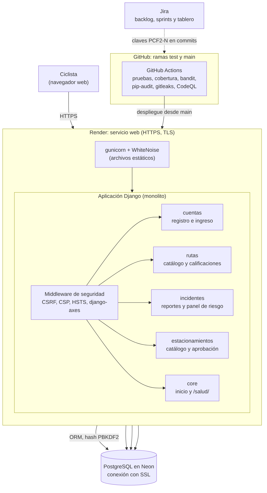

# Arquitectura lógica de CicloSeguro Lima

## Capas y componentes

| Capa | Componente | Responsabilidad |
| --- | --- | --- |
| Presentación | Plantillas HTML de Django y hoja de estilos propia | Interfaz web accesible en español, sin scripts ni estilos en línea (permite una política CSP estricta). |
| Aplicación | Monolito Django con cuatro aplicaciones (cuentas, rutas, incidentes, estacionamientos) y una aplicación central (core) | Casos de uso del negocio: registro e ingreso, catálogo de rutas con calificaciones, reporte de incidentes y panel de riesgo, estacionamientos con aprobación. |
| Seguridad transversal | Middleware de Django (CSRF, CSP, cabeceras seguras, sesiones) y django-axes | Protección de formularios, política de contenido y bloqueo por intentos fallidos. |
| Autenticación | `django.contrib.auth` con PBKDF2 y validadores de contraseña | Cuentas por correo, contraseñas con hash, sesiones con cookies seguras. |
| Servidor | gunicorn y WhiteNoise sobre Render | Atiende la aplicación y los archivos estáticos por HTTPS. |
| Datos | PostgreSQL en Neon con SSL (SQLite solo en local) | Persistencia de usuarios, rutas, calificaciones, incidentes y estacionamientos. |
| Entrega continua | GitHub y GitHub Actions | Ramas, pull requests, pruebas, análisis de seguridad y despliegue. |
| Gestión | Jira (espacio PCF2) | Backlog, épicas, sprints y tablero. |

## Comunicación entre componentes

1. La persona usuaria accede por HTTPS al servicio de Render. Las peticiones HTTP se redirigen a HTTPS y se envía HSTS.
2. gunicorn entrega la petición al middleware de Django, que valida CSRF, aplica las cabeceras de seguridad y comprueba el bloqueo de django-axes en los ingresos.
3. La vista correspondiente consulta o escribe en PostgreSQL mediante el ORM de Django (consultas parametrizadas, sin SQL construido a mano).
4. La respuesta se genera con plantillas con escape automático y se devuelve al navegador.
5. Los cambios de código llegan desde GitHub: cada pull request ejecuta el pipeline y, al fusionar en `main`, se solicita el despliegue a Render.

No hay servicios externos de terceros en tiempo de ejecución: la aplicación no consume APIs de mapas ni de pago, de modo que no hay claves de terceros que proteger.

## Modelo de datos

Ruta (con distritos de origen y destino, longitud, estado de la ciclovía), Calificación (una por persona y ruta), Incidente (tipo, distrito, fecha, visible), Estacionamiento (distrito, tipo, capacidad, vigilancia, aprobado) y el usuario de Django, que se relaciona con calificaciones, incidentes y estacionamientos.

## Limitaciones declaradas

- Los datos de demostración son ficticios.
- No hay mapa geográfico: las rutas, los incidentes y los estacionamientos se organizan por distrito.
- El bloqueo por intentos fallidos usa la base de datos y la combinación de correo e IP; detrás del proxy de Render la IP puede ser la del proxy.
